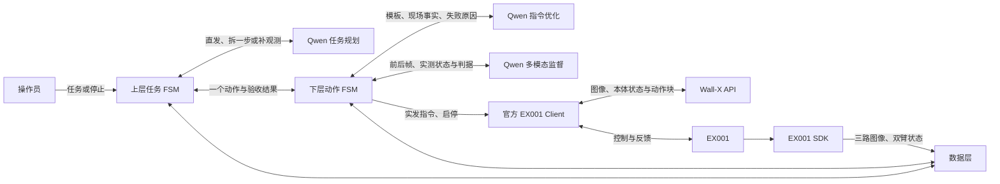

# AGENTS.md

本文件是给 Codex 的项目工作指令，适用于项目根目录及其所有子目录。

## 工作目标

协助小组使用自变量机器人科技有限公司提供的 EX001，完成 ENGI-X 2026 具身智能黑客松挑战赛产品创新赛道的真机作品。培训中称该赛道为“产品创意组”。小组初步选题是家用衣物分类与折叠机器人；后续需求和实现选择以用户确认为准。

## 设计和评审方案时

- 围绕标准工作台上的自主任务展开设计。写方案时说明用户需求、道具、初始摆放和可观察的完成条件。对于衣物整理，分别说明怎样判定一件衣物分对了、怎样判定它叠好了。
- 按产品组规则设计执行流程：由小组的 Agent 分解任务，调用赛方推理 API，并依据执行后的观测选择下一步。现场禁止遥操作，限时 8 分钟，只有 1 次提测机会。调试阶段可不限次数自测，另有 3 次官方评测机会。
- 拆解申报任务时，至少列出 5 个原子动作，将核心步骤与参考表中的标识代码及物理判定标准逐项对照。D3 `Cloth_Fold_Unfold` 同时涵盖抓取两角后对折和铺平，表列参考难度为 3–5。引用表项时保留其原意；具体调用方式查接口文档，真机表现按实际测试记录。[原子动作参考表，D3 见第 25 行](自变量-原子动作参考.xlsx)
- 准备申报材料时，按赛前 48 小时提交 JSON 方案的要求整理步骤、自备道具的照片与规格，可附执行视频。整项任务的难度系数 K 由主办方审核确定。双方签字锁定后，按确认的流程与动作参赛。[方案申报投影片](培训会照片/微信图片_20261123224732_164_87.jpg)

## 接入 Wall-X 推理服务时

- 查云端调用协议，先读自变量官方 API 文档。公开端点为 `wss://maas-api.x2robot.com/v1/vla/wallx`。官方示例从环境变量 `WALLX_API_KEY` 读取密钥，通过 WebSocket 握手头 `Authorization: Bearer <key>` 鉴权。比赛接入时使用赛方下发的地址和凭据；后端模型版本以赛方说明为准。公开服务的密钥申请邮箱为 `wallxapi@x2robot.com`。[官方 API 使用说明](https://x2robot.com/docs/quantax1pro/v1/model-development/wallx-api/api-usage-instruction)
- 为 EX001 构造请求时，按培训中的机型对应关系查阅文档的 **Quanta_X1_Pro（量子一号 Pro）** 小节。先核对实机的 G/H 夹爪型号，再选择对应的 `embodiment` 和夹爪数值范围。文档中带有 `folding clothes` 指令的示例使用 TeleTwin Desktop，可用来理解消息流程；EX001 的状态字段按量子一号 Pro 小节填写。
- 客户端先读取握手元数据，再用 MessagePack 发送任务指令、同一时刻的正面与左右腕部图像，以及机器人状态。响应包含后续动作块。查同步推理、RTC 异步推理及动作帧含义时，以官方协议示例为准。
- 编写或修改 Wall-X API 请求代码时，同时查阅上面的官方 API 文档和[Wall-X 官方 GitHub 仓库](https://github.com/X-Square-Robot/wall-x)。核对握手顺序和 MessagePack 收发时，读 `websocket_policy_server.py` 的 `_handler`。核对观测预处理、推理和动作块封装时，读 `wall_x_policy.py`。若开源实现与托管 API 有差异，在实现说明中指出具体差异，按赛方指定的接口版本与官方云端协议编写请求。

## 使用和维护项目资料时

- 查阅自变量 XR Harness 的 Agent 分工、执行反馈和设备接入方式时，参考 [XR Harness 官方 GitHub 仓库](https://github.com/X-Square-Robot/xr-harness)。小组 Agent 的实现按小组确认的方案设计。
- 比赛时间为 2026 年 12 月 10–13 日，地点为中关村软件园国际软件大厦 2 区。查赛道、赛期及任务完成度、创新性、设计合理性、任务难度和展示效果等评审维度，参考[赛事公众号原文](https://mp.weixin.qq.com/s/Y8lYVp51eSaLL3oOfdKksA)。
- 查培训内容，先用[摘要](培训会摘要.md)定位时间段，再回到[完整录音稿](培训会录音稿.md)或小组的飞书妙记核对。转写中的术语可与[现场照片](培训会照片/)交叉核实。整理录音稿时保留各段原文、发言人和时间戳，术语说明写入摘要。
- 查设备外观和主臂支架，参考 [EX001 设备图](培训会照片/微信图片_20261123224714_155_87.jpg)。使用培训材料时注意组别：模型后训练和“小球入试管”属于技术组任务。
- 给出候选方案时标明哪些是建议。下方空白项等用户提供信息后再补入；只记录已确认的小组决定。

## 衣物类别与分类规则

## 折叠完成条件

## 小组申报动作与顺序

## 技术栈

第二版执行层位于 `action/`。任务规划与指令优化使用千问 AI 平台的 OpenAI 兼容文本接口，动作监督使用支持图片输入的 Qwen 多模态接口。EX001 SDK 提供观测，官方 Client 负责 Wall-X 推理和控制。

## 项目架构

- 从 `python -m action.agent` 进入第二版。机载任务 FSM 持有执行权。对当前待处理指令，任务 LLM 每轮选择原句直发、库内动作加剩余指令、自定义简单动作加剩余指令，或因现场信息不足而补观测。清晰指令首次执行时原文进入 Client 的 `instruction`。
- 单动作 FSM 绑定衣物 ID、动作前置条件与验收目标，结合固定模板、现场事实和 Qwen 优化结果生成拆出动作的指令。监督模型对照动作前后多路图像与机械臂反馈，给出完成度、证据和原因。证据不足先复观测；确认失败后才依据原因决定是否修订重试。当前动作通过后才提交剩余指令，最后与原始任务做整体验收。
- `data/config/` 保存预设提示词、任务约束与原子动作库；`data/task/` 保存任务进度和指令版本的初始格式；`data/scene/` 保存衣物、机械臂和三路图像的格式；`data/logs/` 是事件日志模板。仓库模板使用空值。每次真机运行在 `data/runs/` 建独立目录，保存实际下发指令、验收、帧与日志。
- 衣物台账分别记录预期数、可见数、确认数以及每件的 ID、类型、外形特征和处理状态（未操作、操作中、已操作完）。遇到遮挡保留身份。按折形和归类的实际证据决定是否完成。注册动作和动态分支以签字锁定的参赛流程为准。

详细设计见[第二版架构方案](EX001-小组Agent架构方案V2.md)。
