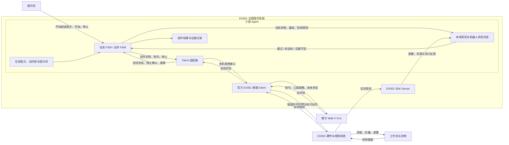
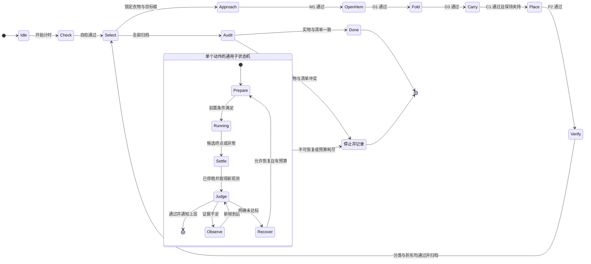

# EX001 衣物分类与折叠 Agent 架构方案

**评审稿 · 2026-11-25**　建议在 EX001 主控上运行一个小组 Agent。它用固定任务配方分解任务，用有限状态机选择下一步，用本地视觉和机器人实测状态验收。官方推理 Client 负责调用赛方 Wall-X VLA 并驱动机器人。这样，现有架构图里的“生成子任务”和“判断是否成功”都在机上完成。任务配方、动作模板和判据均可在赛前逐项审核。[现有项目架构](EX001-当前架构.md) · [产品组培训要求](培训会摘要.md)

## 1. 五个原子动作怎样完成一件衣物

**建议的第一版任务**是按颜色折好并归放两件小号无袖背心。选择背心是为了让一次横向对折有清楚的起点和终点，也使最终轮廓不受外伸衣袖干扰。以下道具、顺序和数值都是设计建议，尚待小组确认。

**工作台布置。** 两件尺寸相同、颜色易区分的背心（如红、蓝）分别放在两个互不相交的操作区，领口朝工作台远边，下摆近侧一小段向上翻起，自由边可见。两件都在各自原位折叠。台面另设两个能平放折好背心的宽放置框，用三角和圆形图案标识；示例映射为红→三角、蓝→圆。各区均须落在双臂可达范围内。哑光台垫上设置尺度标记，衣物可用对比色缝线标出下摆两角和两侧肩部目标点。此布局支持两件衣物互换初始位置，分类结果由实测颜色决定。

| 步骤及官方编号 | 参考表的物理判据 | 在本任务中的实现与动作边界 | Agent 如何验收 |
|---|---|---|---|
| 1 · M1 `Move_Free`，第 2 行 | 末端或底盘在无障碍开阔空间移动超过 10 cm | 空夹爪从上一静止位置移到目标背心上方的预备区。布置时给首件和第二件都留出超过 10 cm 的开阔接近段 | 用同一机器人坐标系下的实测起止末端位置计算位移，至少一个指定末端超过 10 cm，已进入预备区，途中保持净空 |
| 2 · D1 `Soft_Pull_Open`，第 23 行 | 捏住并拉开柔性体 | 捏住上翻下摆的自由边，向机器人一侧拉开，放回台面并松开。目标是露出完整下摆和两角 | 腕部画面可见布边随夹爪移动，随后正面画面中下摆两角到达展开区域，背心达到该尺码的展开长度；保存此时的长度和轮廓 |
| 3 · D3 `Cloth_Fold_Unfold`，第 25 行，参考难度 3–5 | 双角抓取衣物或面巾进行对折、铺平或挂上衣架 | 双手各夹一个下摆角，提起并沿衣长中线横折，将两个角送到同侧肩标附近，落布、松手 | 两个下摆角各自到达对应肩标附近；松手后尺寸、外轮廓和稳定性通过下文的折叠判据。铺平和对折共用 D3 编号 |
| 4 · C1 `Dual_Hold_Move`，第 17 行 | 双手同时接触同一大物体协同搬运，或一臂固定、一臂操作 | 双臂分别夹住折件两侧的双层布边，一起提起并搬至指定图案框上方，保持夹持。道具宽度应允许两手分开持边 | 两处夹点均随折件运动，折件作为整体离开原区、未明显散开；实测双手和折件位于目标框上方。单侧脱落立即打断搬运 |
| 5 · P2 `Place_Coarse`，第 10 行 | 平稳放置在指定台面，允许的位置容差大于 2 cm | 从当前夹持位下降至折件受台面支撑，再松手、退出。放置框可设计为中心允许偏差 3 cm，尺寸仍能容纳整件折衣 | 用腕部画面和末端高度序列确认先落台后松手；退出后折件稳定且完全在目标框内，再分别复核分类与折叠 |

五个编号各对应一个独立可观察的物理阶段。D1 针对初始翻边做局部拉开，D3 从完整展开轮廓开始做双角对折。若最终申报道具改为完全平放，应同步调整动作配方和申报项。表中难度是动作参考值，整项任务的 K 由主办方审核。[原子动作参考表，Sheet1 的 B–E 列](自变量-原子动作参考.xlsx)

### 动作如何封装

| 封装内容 | 约定 |
|---|---|
| 动作定义 | 每个编号绑定一份记录，包含输入槽位、前置条件、提示词模板、执行中止条件、完成判据、超时和允许的恢复入口。编号只供本地调度与申报使用 |
| 动作实例 | 每次派发绑定本轮任务、衣物 ID、动作编号、尝试序号、操作区和目标框。D3 附两组“下摆角→肩标”对应关系；C1、P2 共用同一件衣物、同一目标框及夹持交接记录 |
| 观测与回执 | 派发前保存带时间戳的基线。执行器回报运行、已停止或故障；判定器另行返回通过、未达标或证据不足，并附关键帧、测量值和原因。只接受当前尝试对应的回执 |
| 结束与交接 | 执行中监看完成迹象；达到候选终点后结束该次推理，待 Client 确认无旧动作可继续下发、SDK 实测运动稳定，再取新帧验收。C1 的终态要求双手仍夹持，作为 P2 的前置条件 |

**单件验收分两次。** D3 完成后，在本件操作区保存折好基线；P2 完成后，在分类区重新检验，以发现搬运时散折的情况。建议采用以下可复核的口径。

- **叠好了。** D3 落布时，两下摆角到各自肩标的台面投影距离建议均不超过 2 cm。松手后，沿衣物自身长轴测得的折后长度建议为本件展开基线的 45%–60%，两侧无超出目标折形包络的大片散布。P2 后将轮廓平移、旋转到 D3 基线比较，同时复核可见角标。若关键标记互相遮挡，应通过缝线错位布置保证可见，或将本次判为证据不足。
- **分对了。** 本件从输入区识别并锁定的颜色与目标框映射一致，最终独立识别到同色折件，整个轮廓位于正确框内，夹爪均已离开。两件分别计数；最终还要确认两个输入区均空、两个输出框各恰有一件。分类正确与折形合格分别记录。
- **判定的尺度。** 台面标定负责把平放衣物的像素距离换算成厘米；空中转运时用 SDK 末端位姿和腕部画面判断高度、夹持和共同运动。稳定性可先取松手后连续 0.5 秒有效观测，各数值需按相机视角、标记尺寸与布料特性标定。

## 2. 机载模块、工作状态与次态逻辑

### 部署边界

| 机上组成 | 职责与接口 |
|---|---|
| 小组 Agent 主进程 | 建议采用与机载 SDK 兼容的 Python 环境，按主控 CPU 架构打包 SDK、OpenCV 和本地配置。一个事件循环独占状态迁移权。加载赛前确认的任务配方、动作库、区域标定、判定阈值和计时预算；启动后先待命 |
| 观测与判定模块 | 独立采集任务通过 SDK Server 只读获取正面图、左右腕图、末端与夹爪反馈。按时间戳组合观测并检查新鲜度。依据台垫标记校正透视，通过颜色分割、连通轮廓、缝线定位和前后帧运动生成证据；过期、遮挡、颜色冲突或观测不同步均输出“证据不足” |
| Client 适配器 | 建议作为机上局部进程，受 Agent 的单一任务会话管理。接收一个动作实例和一条指令，使用官方 EX001 Client 的同步入口；监视、停止该会话并向 Agent 回报。若 Client 位于官方容器内，可在该环境内设置窄接口接收本机启停请求。小组动作名、回执和尝试号是拟建的本地接口 |
| 官方推理与控制链 | 官方 Client 取得同期三路图像和 Quanta_X1_Pro 完整状态，鉴权并先读取握手元数据，以 MessagePack 发送指令与观测，接收动作块并插值下发。桌面任务采用仅双臂和夹爪动作配置。赛方服务是此方案唯一的云端推理依赖 |
| 运行记录与停止 | 保存配置版本、每件衣物的前后帧、数值、回执、耗时和失败原因。操作员赛前选定配方和参数，赛中只允许停止。进程重启后回到待命；中断时保留现场与记录，避免自动重放上一次动作 |

**机型适配。** 官方文档给出容器内的 `start_ex001.sh`、同步模式、任务指令参数及双臂运行配置。部署包要匹配实际的 x86 或 Orin 主控、官方 Client 版本、SDK 版本、相机构型及 G/H 夹爪；比赛地址与凭据由赛方下发。软件的常规动作停止和设备急停各走各自的路径。[官方 EX001 Client 启动说明](https://x2robot.com/docs/quantax1pro/v1/model-development/wallx-api/client-run) · [官方 Wall-X 协议](https://x2robot.com/docs/quantax1pro/v1/model-development/wallx-api/api-usage-instruction) · [SDK 感知模块](https://x2robot.com/docs/quantax1pro/v1/sdk/api-overview/perception-module)

**最重要的上机接口条件是 C1→P2 的夹持连续性。** 官方示例支持启动同步推理，且示例带有停止后回零的选项。本方案要求结束旧指令时可以停稳、保留夹持，并确认旧会话已退出；子任务切换时禁用自动回零。赛方版本的“停止后保持夹持、清空待执行动作”语义仍待核实。若只支持整段运行与停止，可把 C1 和 P2 放在同一条“搬到框内并平放”的 Client 指令里，机上 FSM 连续记录两阶段证据。此时 P2 的前置条件只作为监测门槛；如果规则要求由 Agent 验收后才允许释放，应采用支持保持和分段授权的 Client 接口，未确认前不采用合并方案。[官方 Client 同步运行与停止配置](https://x2robot.com/docs/quantax1pro/v1/model-development/wallx-api/client-run)

### 两层有限状态机

上层回答“正在整理哪一件、下一步是什么”，下层回答“当前动作到了什么阶段、证据能否支持推进”。每件衣物保存 ID、已识别颜色、目标框、已通过的动作和验收基线。任务从现场开始信号起用单调时钟计时，启动、推理等待、停稳、复观测和恢复都计入 480 秒。

| 上层状态 | 进入时执行 | 转移条件及次态 |
|---|---|---|
| 待命 | 加载配方和标定，保持无活动任务 | 收到一次开始信号 → 自检 |
| 自检 | 检查相机/状态源、Client 可用性、桌面标记、可达配置、夹爪型号和输出框初始为空 | 就绪 → 选件；缺项且无法在预算内恢复 → 停止 |
| 选件 | 按固定操作区顺序选未归档衣物，锁定颜色、衣物 ID、目标框及输入基线 | 单件可辨且目标框空 → M1；有歧义 → 复观测；清单全部归档 → 终检；预期件缺失 → 复观测 |
| M1 接近 → D1 拉开 → D3 对折 → C1 搬运 → P2 放置 | 每一项都是单独的上层状态，分别调用对应动作实例 | 当前动作经下层验收通过 → 表中下一个动作；P2 通过 → 单件复核；未达标或证据不足 → 按下表处理 |
| 单件复核 | 独立检查当前衣物归位和折形，比较 D3 基线 | 两项均通过 → 归档本件并返回选件；归类错误、折件散开或身份不明 → 有界恢复或停止 |
| 终检 | 清单与全桌面实物逐件核对 | 所有预期件均有两项通过记录，且最终画面一致 → 完成；证据不足 → 复观测；可见结果与记录冲突 → 停止并记录 |
| 完成／停止 | 结束任务会话，记录终态、耗时和逐件结果 | 本轮终态。停止时按设备支持的方式中止执行并标记是否已确认停稳 |

| 下层状态 | 次态逻辑 |
|---|---|
| 准备 | 检查该动作前置条件、执行权、观测新鲜度和剩余时间。满足 → 派发；已观测到候选终态且属于本次已有尝试 → 验收；条件不清 → 复观测 |
| 派发／运行 | 一次仅允许一条活动指令。处于预计进展区间时继续同一会话；出现候选终点、无进展、超时、掉布或观测丢失 → 请求停止当前会话并等待停稳。每个请求均受全局截止时间约束 |
| 停稳／验收 | 核对会话终止、末端稳定和夹持要求。停稳确认超时 → 停止本轮。取停稳后的新帧，结合运行中保存的双手接触等过程证据：通过 → 上层推进；未达标 → 恢复；证据不足 → 复观测 |
| 复观测 | 保持当前姿态，再取一组新鲜观测，送回触发复观测的判定点。可见结果已达标则直接验收；超过观测窗口仍不确定 → 停止。此状态也供上层选件、单件复核与终检使用 |
| 恢复 | 只走配方中预先登记的边。例如 D1 漏抓且布边仍可见 → 按新边位重试 D1；D3 对折不齐、衣物仍在原区且两角可辨 → 用 D3 铺平、重建展开基线，再做 D3 对折；P2 回执丢失但已静止 → 先复核实际放置结果。衣物掉出台面、目标身份丢失或持物状态不确定 → 停止 |

**事件优先级。** 人工停止或硬件故障优先，其次是全局截止、执行权丢失、持物掉落、观测过期，再处理正常完成。每个失败动作建议最多恢复一次，每件衣物另设共享恢复预算，跨状态回退也消耗该预算。若剩余时间不足以执行该步并安全停止，直接结束本轮。较早尝试的迟到回执、云端响应和图像不能推进当前状态。八分钟现场只有一次提测，自动恢复必须事先纳入申报流程。[培训录音稿，32:30–38:28](培训会录音稿.md)

## 3. 给 Wall-X 的候选提示词

组员用中文列起草、修改和审核动作。英文列是本版拟交给 Client 的 `instruction`，可在赛前按定稿的中文逐条校对，运行时直接从本地模板取用。自变量在 XR Harness 的任务指引中明确写道“交流跟随用户语言，VLA 指令默认简洁英文”。Wall-X API 文档给出了英文动作示例；截至 2026-11-25，所查官方资料中未找到赛方后端在 EX001 同一叠衣任务上的中英文成功率对照，中文直发的性能差距仍待确认。[官方任务指令指引](https://github.com/X-Square-Robot/xr-harness/blob/main/xr-brain/contrib/xr-agent-plugin/packages/xr-preset/skills/xr-task-instructions/SKILL.md) · [官方 Wall-X API 说明](https://x2robot.com/docs/quantax1pro/v1/model-development/wallx-api/api-usage-instruction)

| 用途 | 中文提示词（组员编辑与审核） | 英文提示词（拟下发） |
|---|---|---|
| M1 空手接近 | 保持两只夹爪张开，移到{颜色}背心下摆正上方，悬停在布面上方。 | Move the open grippers above the bottom hem of the {color} shirt. Hover above the fabric. |
| D1 拉开翻边 | 捏住{颜色}背心向上翻起的下摆边缘，朝远离领口的方向拉开。将下摆平放在台面上，再松开。 | Pinch the turned-up hem of the {color} shirt. Pull it away from the neckline, lay it flat, and release it. |
| D3 横向对折 | 两只夹爪各夹住{颜色}背心的一个下摆角。把下摆向领口对折，让两个角分别对准同侧肩部标记。放下布料，再松开。 | Grasp the two bottom corners of the {color} shirt, one in each hand. Fold the hem up to the matching shoulder marks, lay it down, and release. |
| C1 双臂搬运 | 从折好的{颜色}背心两侧各夹住两层布，一起提起，移到台垫上带{图案}标记的放置框上方，保持夹持。 | Grip both layers at opposite sides of the folded {color} shirt. Lift it with both hands and hold it above the area marked with a {symbol} on the mat. |
| P2 平稳放置 | 把折好的{颜色}背心放到带{图案}标记的框内。衣物落在台垫上后松开夹爪，再将双手移开。 | Lower the folded {color} shirt onto the mat inside the area marked with a {symbol}. Release it on the mat and move both hands clear. |
| D3 铺平恢复 | 两只夹爪各夹住{颜色}背心下摆的一个标记角，朝远离领口的方向展开背心。将背心铺平，再松开。 | Grasp the two marked hem corners of the {color} shirt. Unfold it away from the neckline, lay it flat, and release it. |

两列共用本地分类映射。颜色为红色／red、蓝色／blue，框边图案为三角形／triangle、圆形／circle。复核 AI 改写稿时，尤其要核对 D3 的两个下摆角是否各自对应同侧肩标，C1 是否结束于“框上方仍夹持”，P2 是否要求“落台后再松开”。这三个条件决定下一状态能否接手。

## 4. Markdown 架构图

第二张图的通用子状态机供 M1、D1、D3、C1、P2 分别调用。任一活动状态收到人工停止、硬件故障或截止事件，均可直接进入“停止并记录”。机型适配、Client 停止语义、双层夹持可行性、标记可见性及两件衣物的总耗时均属后续上机确认项。本稿供小组评审，尚未进行实现、安装或真机调试。
