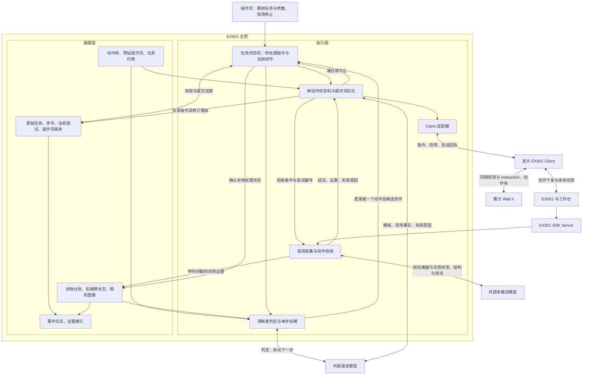

# EX001 小组 Agent 第二版架构

**设计稿 · 2026-11-25**　目标是在标准工作台上，按用户要求整理衣物。小组已确定引入外部语言模型和多模态监督。机载 Agent 保存任务进度、持有执行权；语言模型每轮决定当前指令能否直接执行，多模态模型依据现场证据判断动作结果。官方 Client 调用 Wall-X 获取动作块并驱动 EX001。外形识别、折叠质量与分类结果都需要独立的观测依据。[Wall-X 官方 API 说明](https://x2robot.com/docs/quantax1pro/v1/model-development/wallx-api/api-usage-instruction) · [官方 EX001 Client](https://x2robot.com/docs/quantax1pro/v1/model-development/wallx-api/client-run)

## 1. 总体架构

语言模型和多模态模型是两个**职责**，可以使用同一多模态服务的独立请求，也可分别部署。规划请求使用任务和已确认的场景摘要；监督请求单独看现场图像和验收条件，避免上一轮模型的自述成为“成功证据”。地址和模型版本留给部署配置。

## 2. 数据层保管什么

| 数据 | 核心内容 | 写入时机与用途 |
|---|---|---|
| 预设提示词与动作库 | 官方动作编号、原义、物理判据、模板版本；自定义简单动作的模板、可观测终态和适用条件；赛前锁定的动作范围与恢复分支 | 赛前维护。规划器用于匹配动作，优化器用于生成指令，监督器读取同一份验收条件 |
| 任务与提示词版本 | 原始任务、当前待处理指令、候选剩余指令、衣物 ID、当前动作、尝试编号、基准指令、实际下发指令、优化前后差异及理由 | 保留全部尝试。本轮优化只作用于当前实例；赛后由组员审核是否纳入预设模板 |
| 机械臂与相机观测 | 左右末端位姿、夹爪反馈、Client 会话状态；正面与左右腕图、采集时间、相机身份、尝试编号 | 每次动作保存执行前基线、关键过程帧和停稳后的结果。图像单独保存，日志引用帧号。重采后可以追溯模型当时看到了什么 |
| 衣物模型 | 场景记录预期件数（如已知）、当前可见件数、已确认的唯一衣物数；每件记录稳定 ID、类型、颜色、轮廓、朝向、领口/下摆/可见角等外形特征，以及位置、遮挡、夹持、折形、目标区、处理状态 | 开始时建立台账，动作后更新。遮挡导致件数下降时保留既有 ID 并标记“暂不可见”；同色衣物用位置连续性、外形和夹持轨迹关联。身份有歧义时先复观测 |
| 运行日志 | 模型与模板版本、状态转移、实际下发文本、会话启停、超时、动作结果、原因与证据、剩余时间 | 按任务／衣物／动作／尝试串联，支持回放一次错抓、误判或错误改写 |

**处理状态只设三种。** 建档为“未操作”；首个动作实际派发时变为“操作中”；该件衣物的全部用户目标均经验证后变为“已操作完”。例如用户要求“折好并分类”，折好后先记录“折形已通过”，搬运、入框及最终折形复核结束后才改为“已操作完”。若后续观测发现折件散开，可重开为“操作中”并记录原因。执行失败、暂时遮挡和类别待核实分别记录，不覆盖处理状态。

## 3. 顶层状态机怎样动态决定步数

顶层状态为 **接收任务 → 建立观测 → 判定当前指令 → 执行一个动作 → 提交结果 → 判定剩余指令／终检**。机上 FSM 控制循环；语言模型每次只回答“眼前这一条怎样执行”。用户原始任务全程保留，终检与它逐项核对。

| 判定结果 | 触发条件 | 本轮交付给动作状态机的内容 |
|---|---|---|
| **原句直发** | 目标衣物可唯一定位、动作及终态明确、前置条件已满足，可以作为一次连续操作交给 Client，中间无需根据观测再选分支 | 当前指令**原文**作为首次 `instruction`，候选余令为空；另附衣物 ID、验收条件、约束。原句的语言和措辞均保留 |
| **库内动作＋余令** | 整句仍含待决目标或依赖，但可执行的第一项能对应动作库的物理判据 | 给出一个动作编号、衣物 ID、参数、成功条件和候选余令。例如衣物需要先展开时，选择 D3 的铺平操作，余令保留后续折叠与归类要求 |
| **自定义简单指令＋余令** | 没有合适库项，但能描述一个当前可执行、有独立可观察终态的操作 | 生成一个自定义简单动作，标记为“自定义”，用通用模板封装。例如“把台面上平放的背心旋转到领口朝向三角标记”，完成依据是领口与标记的方位关系 |
| **信息不足** | 例如“把这件放回原处”，画面有两件同款衣物，记录中也没有原位置 | 先补取多视角观测或查任务起始记录，再判定；赛前可澄清用户意图，正式计时后仍无法消歧则记录原因并停止 |

**一轮的提交规则。** 拆解时同时保留拆前指令、当前动作和候选余令，并把“所有衣物”“保持折形”“按颜色入框”等跨步约束绑定到对应动作及余令。只有当前动作验收通过，FSM 才一次性提交证据、衣物状态和新余令；失败时仍处理同一动作。余令若已是简单动作，下一轮直接执行；余令为空则进入整任务终检。若现场已经满足某项目标，可用新证据核销该项，避免把已折好的衣物再折一次。

**何时应拒绝一次拆解。** 候选动作须能推进当前目标，余令须保留尚未完成的义务。原句被反复换一种说法、选中已完成衣物或尝试超出申报范围的动作时，机载协调器退回本轮结果。无进展重复、重试预算耗尽或距 8 分钟截止已不足以执行并停稳时，进入停止状态。比赛的动态选择限定在已签字的流程和分支内，申报仍需对照至少 5 个原子动作。第一版列出的 M1、D1、D3、C1、P2 可作为申报候选；具体代码、物理判据和道具约束见[动作映射表](EX001-叠衣小组Agent架构方案.md)与[培训摘要](培训会摘要.md)。

## 4. 单动作状态机与提示词优化

| 状态 | 动作与转移 |
|---|---|
| 准备 | 锁定衣物与尝试编号，记录前置状态、原始目标和成功判据。取动作前画面；若已满足判据则直接交验 |
| 生成指令 | **直发首轮**使用原句，固定模板在本地补齐监督和日志字段。**拆出动作**使用“动作固定模板＋LLM 填写或优化”。两条路径随后共用执行、验收与恢复流程 |
| 执行与监看 | 适配器仅允许一个活动会话。Client 接收最终 `instruction`；监督器以最新观测区分执行中、候选完成、明显失败和视野丢失。仍在正常接近目标时继续本次动作 |
| 停稳与验收 | 出现候选完成、明显失败或超时时，结束当前动作会话。确认旧动作已停止，再用新帧及必要的过程证据验收；持物动作还要核验停稳后的夹持状态 |
| 修订或恢复 | 已观察到具体失败且前置条件仍成立 → LLM 根据原因改写本动作的可变字段，创建新尝试；现场已有部分成功 → 从实测状态接续；前置条件已破坏 → 在允许范围内插入必要恢复动作，之后重新评估原目标。原余令始终保留 |
| 通过或终止 | 通过 → 向顶层提交一次结果；证据不足 → 先补观测；物理状态不明、模型持续不可用、超时或无法恢复 → 停止并保存原因。迟到的模型回包按尝试编号过滤 |

### 三类提示词

| 使用者 | 固定模板应该约束什么 | 实例中的可变内容 |
|---|---|---|
| 规划 LLM | “结合当前观测判断这条指令能否直发。需要拆解时，只给一个动作、它的验收条件和剩余指令；优先匹配动作库并说明对应的物理判据。无法确定指代时指出缺少哪项观测。” | 当前余令、衣物台账、已完成事实和当前可用动作 |
| 动作优化 LLM | “对指定衣物执行指定动作。写清可见部位、运动方向、目标位置和释放或持握终态。依据本次现场事实及失败原因，输出一条可直接下发的动作指令。” | 可细化抓取部位、可见标记、方向和先后关系；衣物身份、用户目标、锁定的完成判据、必须保持的夹持约束不可改。组员用中文审核预设模板；拆出动作的下发语言可配置，建议沿用第一版的英文基线 |
| 监督多模态模型 | “比较动作前、过程中和停稳后的观测，逐项核对成功条件。给出结论、依据的帧号／状态、尚未满足的条件、可能原因及其不确定性。” | 本动作的成功条件、同步图像、末端和夹爪反馈。可见事实与推测分开填写，供优化器判断哪些内容可以写进新指令 |

**D3 反馈示例。** 双角对折后，左下摆角已对齐左肩标，右下摆角仍平放在原位。监督器返回“未完成”，标记左右两处图像证据；若图像不足以区分漏抓和滑脱，就保留两种解释。优化器可写“保持已对齐的左侧，将仍在台面的右下摆角移至右肩标，放稳后松开”，并继续按原 D3 目标检查两角。若右角被手腕遮住，先补观测。若实际问题是 Client 断连，转入会话故障处理，核实现场后再决定是否补做。

## 5. 桌面实例与最终验收

**示例布置。** 红、蓝两件无袖背心分开放在标准工作台上；三角框收红色，圆框收蓝色。框边标记在衣物落下后仍可见。衣物、标记与分类映射供讨论，具体道具和容差以小组申报为准。

假设用户说“把两件背心都叠好，按颜色放进对应的框”。开始观测显示红件下摆翻起、蓝件已经折好且位于圆框。监督器先核对蓝件折形、颜色和位置，证据齐全则归档。红件可先拆为“D1 拉开红件下摆”＋“把红件对折并放入三角框”；D1 通过后再判定这条余令。若需要中途验折，拆出 D3 并暂存归放余令。D3 通过后，“把折好的红背心放进三角框”已可连续执行，就将这句原文交给 Client。若红件 D3 未通过，归放余令停留在候选状态。这是一次可能的场景轨迹，实际动作数取决于进场状态、用户任务和申报允许的分支。

**终检输出两项独立结果。** 每件“叠好了”需要有与该衣型对应的折形证据，例如两下摆角与对应肩标对齐、松手后轮廓稳定，搬运后再次确认。“分对了”需要最终画面显示该件整体位于其类别对应区域，并已脱离夹爪。全桌终检再把已确认件数、每件目标和最终实物对齐。某件缺乏身份或折形证据时保留未决项，即使余令已经为空也不会宣告整任务完成。

实现入口见 [action/agent.py](action/agent.py)。端到端时延、动作切换时的夹持保持，以及分类和折形验收准确率仍待真机验证。
